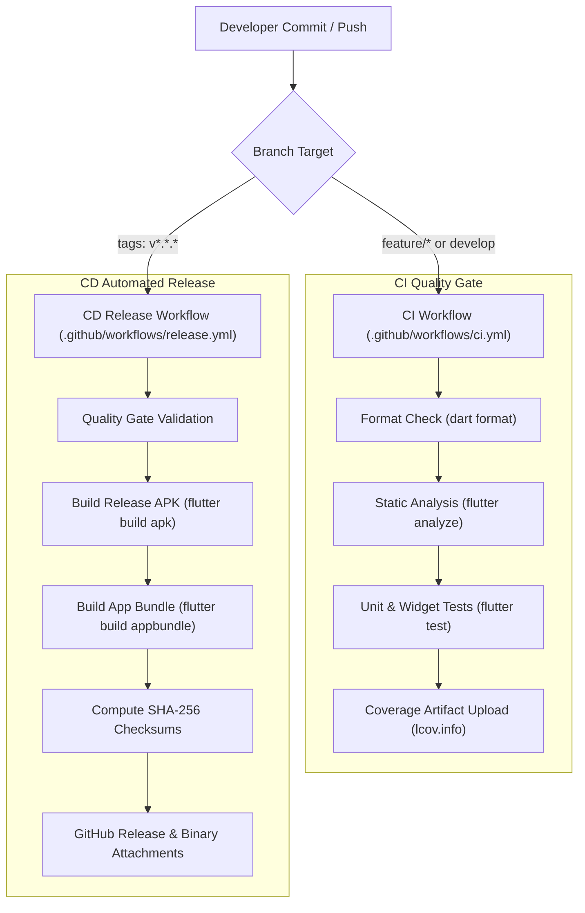

# 🛠️ MOBILE DEVOPS & CI/CD ARCHITECTURE
## Project: Flip to Focus (`com.fliptofocus.app`)
**Status:** Active Production Specification  
**Language:** English (Technical Reference)

---

## 1. PIPELINE OVERVIEW



---

## 2. GITHUB ACTIONS WORKFLOWS

### 2.1. Continuous Integration (`.github/workflows/ci.yml`)
* **Triggers:** Every push and pull request to `main` and `develop`.
* **Execution Environment:** `ubuntu-latest` with Java 17 (Temurin) and Flutter stable channel.
* **Gated Steps:**
  1. `dart format --output=none --set-exit-if-changed .` — Ensures formatting consistency.
  2. `flutter analyze --fatal-infos` — Strictly forbids any warnings, lints, or unused imports.
  3. `flutter test --coverage` — Runs all unit and widget tests and generates LCOV coverage metrics.

### 2.2. Continuous Delivery & Release (`.github/workflows/release.yml`)
* **Triggers:** Git tags matching `v*.*.*` (e.g. `v1.0.0`, `v1.0.1`).
* **Artifacts Produced:**
  * `app-release.apk` (Direct test install for phones without store).
  * `app-release.apk.sha256` (Cryptographic verification).
  * `app-release.aab` (Production bundle for Google Play Console).
  * `app-release.aab.sha256` (Cryptographic verification).
* **Release Output:** Automatically published to the GitHub Releases page with changelog notes.

---

## 3. LOCAL DEVELOPER TOOLING (`scripts/`)

Three specialized scripts are provided in `scripts/` to accelerate local development:

| Script | Purpose | Command |
|---|---|---|
| **`verify.sh`** | Runs format checks, static analyzer, and test suite locally before pushing. | `./scripts/verify.sh` |
| **`build_release.sh`** | Compiles release APK and AAB, computes hashes, and reports binary file sizes. | `./scripts/build_release.sh` |
| **`install_wifi.sh`** | Connects to your phone over Wi-Fi (Wireless ADB) and installs the APK without cables. | `./scripts/install_wifi.sh` |

Make sure scripts are executable:
```bash
chmod +x scripts/*.sh
```

---

## 4. FASTLANE AUTOMATION (`android/fastlane/`)

Fastlane provides developer lanes for rapid testing and deployments:

```bash
# Run tests and linter
bundle exec fastlane test

# Build standalone release APK
bundle exec fastlane build_apk

# Build Google Play App Bundle
bundle exec fastlane build_bundle

# Deploy to Google Play Internal track
bundle exec fastlane deploy_internal
```

---

## 5. REPOSITORY SECRETS FOR SIGNED PRODUCTION BUILDS

To enable automated production signing in GitHub Actions, add these secrets to your GitHub repository under **Settings -> Secrets and variables -> Actions**:

| Secret Name | Description | Example / Format |
|---|---|---|
| `ANDROID_KEYSTORE_BASE64` | Base64-encoded release `.jks` file | `cat upload-keystore.jks \| base64 -w 0` |
| `KEYSTORE_PASSWORD` | Password of the keystore | Plaintext string |
| `KEY_ALIAS` | Key alias name inside the keystore | `upload` |
| `KEY_PASSWORD` | Key password | Plaintext string |
| `GOOGLE_PLAY_JSON_KEY` | Service account JSON key for Play Console API | Raw JSON content |

---

## 6. SEMANTIC RELEASE PROCEDURE

To create a new official release:
1. Ensure all tests and analysis pass locally:
   ```bash
   ./scripts/verify.sh
   ```
2. Update the version in `pubspec.yaml` (e.g. `version: 1.0.1+2`).
3. Commit and tag the release:
   ```bash
   git commit -am "chore: release version 1.0.1"
   git tag v1.0.1
   git push origin main --tags
   ```
4. GitHub Actions will automatically compile, sign, verify, and publish the release binaries on GitHub!
