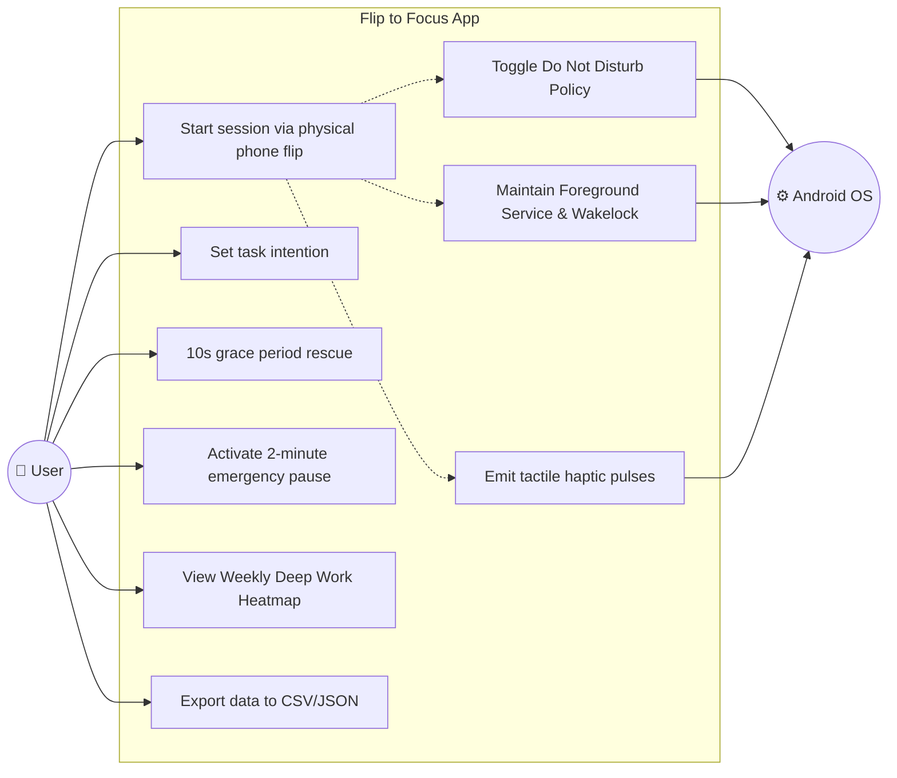
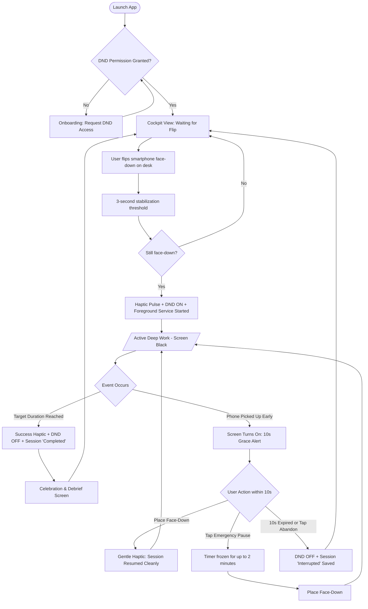
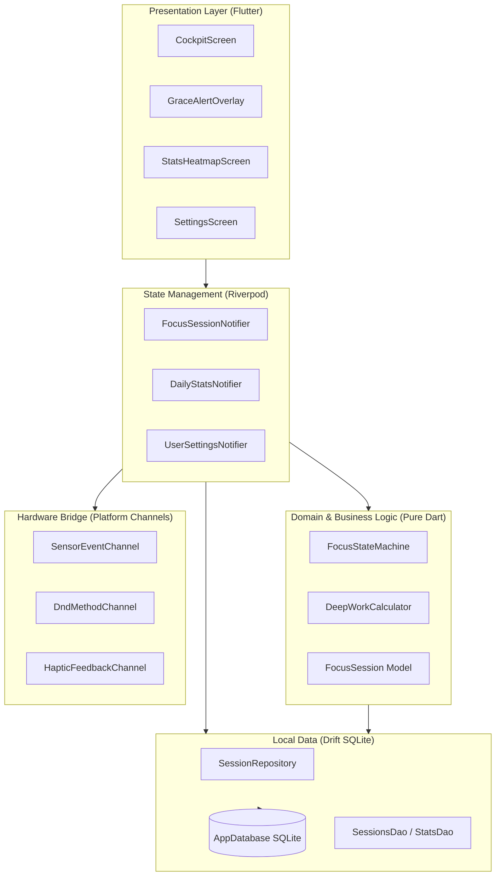
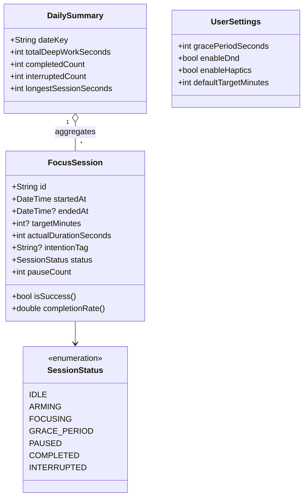
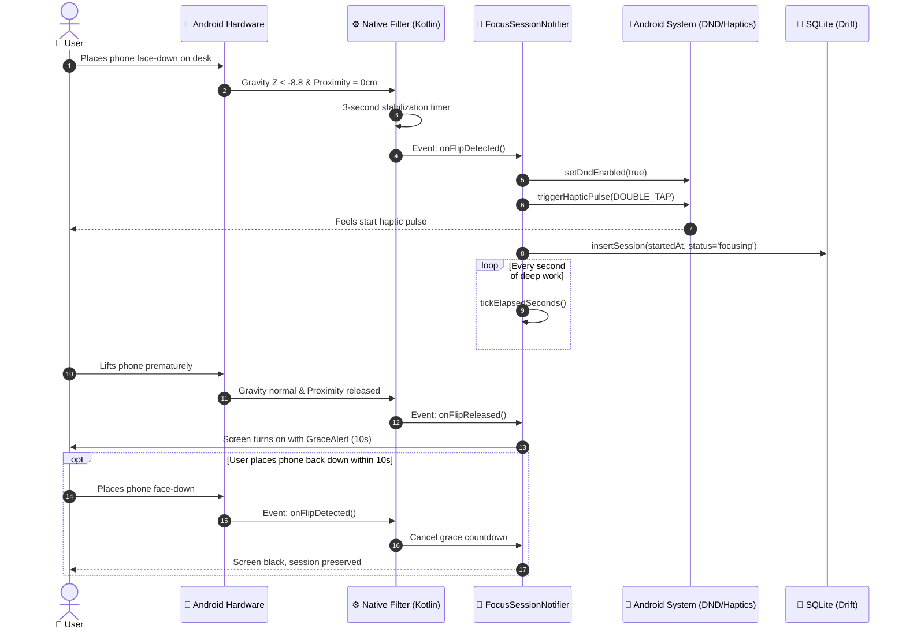
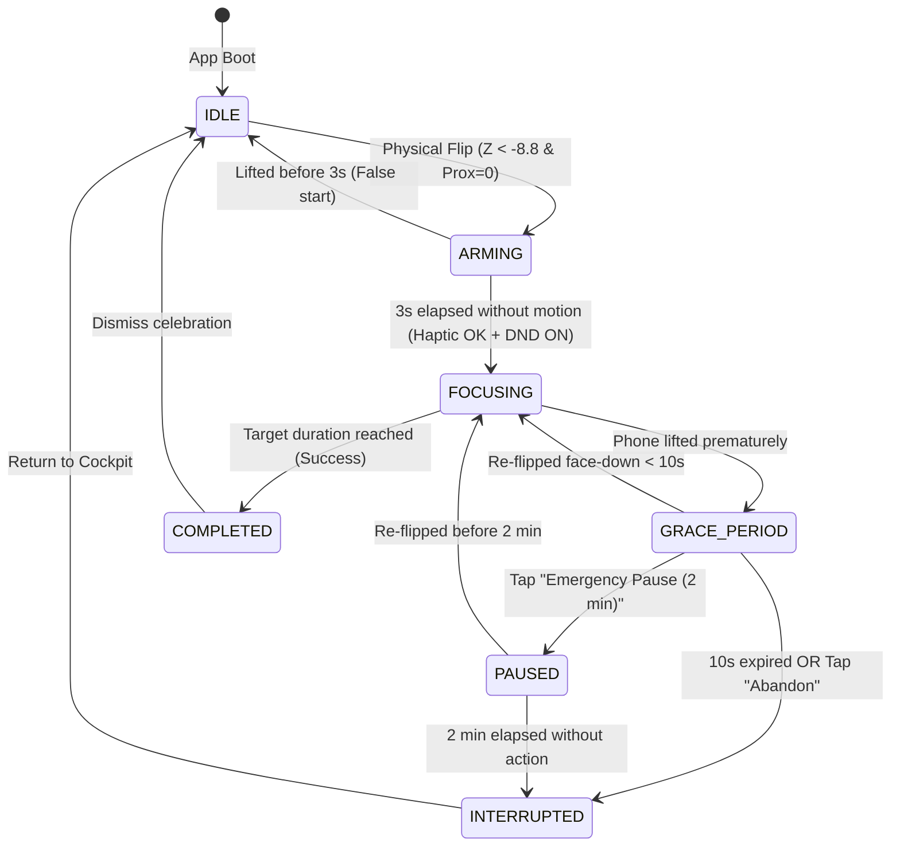
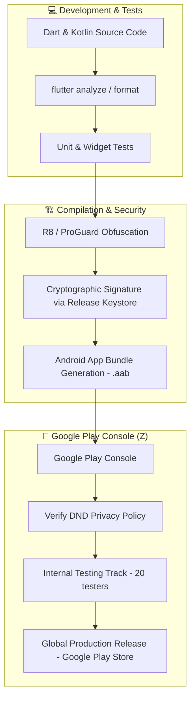

# 📐 END-TO-END SYSTEM MODELING (A TO Z: GESTURE TO PLAY STORE)
## Project: Flip to Focus
**Status:** Approved Engineering Specification  
**Scope:** From Requirements Analysis (A) to Google Play Store Release (Z)  

---

## 📑 TABLE OF CONTENTS

1. [ARCHITECTURAL OVERVIEW: FLUTTER & NATIVE KOTLIN](#1-architectural-overview-flutter--native-kotlin)
2. [THE 7 CORE SYSTEM DIAGRAMS (A -> Z)](#2-the-7-core-system-diagrams-a---z)
3. [DIAGRAM 1: USE CASE DIAGRAM](#diagram-1-use-case-diagram)
4. [DIAGRAM 2: ACTIVITY / USER FLOW DIAGRAM](#diagram-2-activity--user-flow-diagram)
5. [DIAGRAM 3: COMPONENT DIAGRAM](#diagram-3-component-diagram)
6. [DIAGRAM 4: DOMAIN & CLASS DIAGRAM](#diagram-4-domain--class-diagram)
7. [DIAGRAM 5: SEQUENCE DIAGRAM](#diagram-5-sequence-diagram)
8. [DIAGRAM 6: FINITE STATE MACHINE (FSM) DIAGRAM](#diagram-6-finite-state-machine-fsm-diagram)
9. [DIAGRAM 7: CI/CD & PLAY STORE DEPLOYMENT PIPELINE](#diagram-7-cicd--play-store-deployment-pipeline)

---

## 1. ARCHITECTURAL OVERVIEW: FLUTTER & NATIVE KOTLIN

* **95% Dart / Flutter:** All UI components, animations, Riverpod state, and Drift database queries.
* **5% Native Android Kotlin:** Hardware sensor listeners (proximity & gravity) and DND policy management via Platform Channels.

```
+--------------------------------------------------------------+
|                     FLUTTER CODE (DART) 95%                  |
|   UI (Screens, Theme, Animations) + State (Riverpod) + DB   |
+--------------------------------------------------------------+
                               |
                   [ Method / Event Channel ]
                               |
+--------------------------------------------------------------+
|             NATIVE ANDROID LAYER (KOTLIN) 5%                 |
|   Proximity Sensor | Gravity Sensor | Do Not Disturb        |
+--------------------------------------------------------------+
```

---

## 2. THE 7 CORE SYSTEM DIAGRAMS (A -> Z)

| Phase | Diagram Name | Purpose |
| :--- | :--- | :--- |
| **A. Requirements** | **1. Use Case Diagram** | User roles and core capabilities. |
| **B. User Flow** | **2. Activity Diagram** | Step-by-step user decision paths. |
| **C. Architecture**| **3. Component Diagram** | Clean Architecture module boundaries. |
| **D. Data Models** | **4. Class Diagram** | Domain entities and methods. |
| **E. Dynamics** | **5. Sequence Diagram** | Chronological messaging across subsystems. |
| **F. Lifecycles** | **6. State Machine Diagram**| Exact FSM state transitions. |
| **Z. Release** | **7. CI/CD & Play Store** | From compilation to production Play Store release. |

---

## DIAGRAM 1: USE CASE DIAGRAM



---

## DIAGRAM 2: ACTIVITY / USER FLOW DIAGRAM



---

## DIAGRAM 3: COMPONENT DIAGRAM



---

## DIAGRAM 4: DOMAIN & CLASS DIAGRAM



---

## DIAGRAM 5: SEQUENCE DIAGRAM



---

## DIAGRAM 6: FINITE STATE MACHINE (FSM) DIAGRAM



---

## DIAGRAM 7: CI/CD & PLAY STORE DEPLOYMENT PIPELINE


